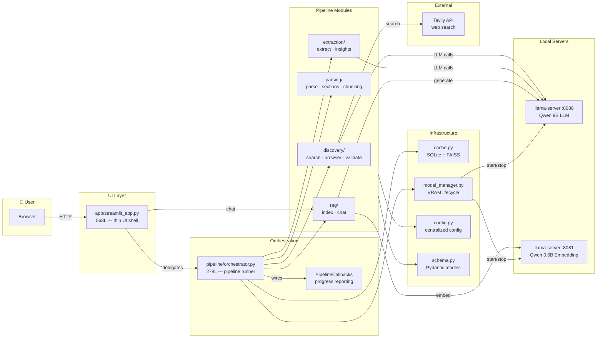
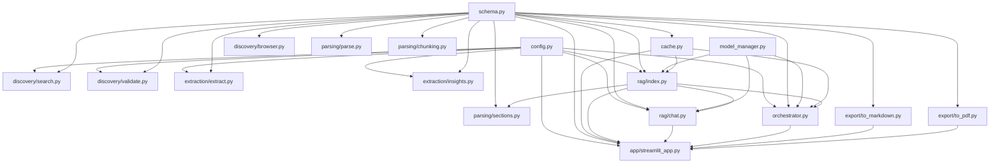
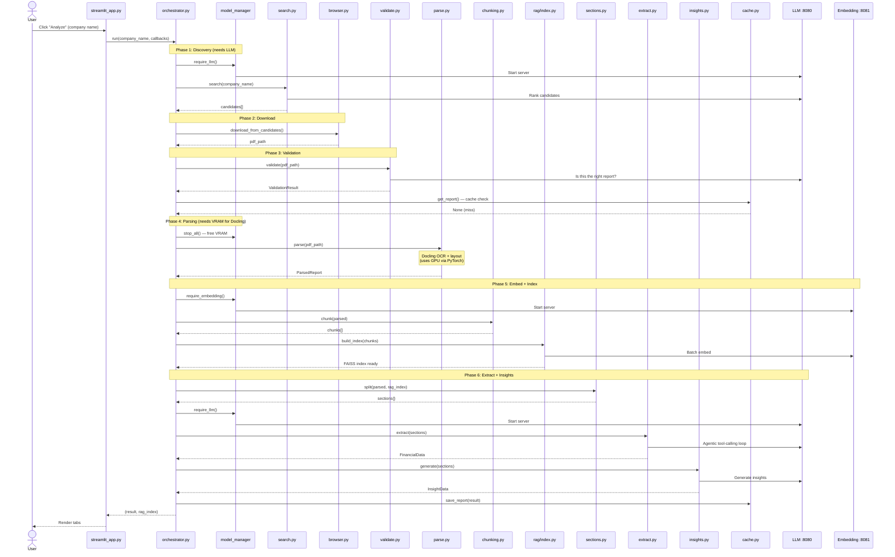
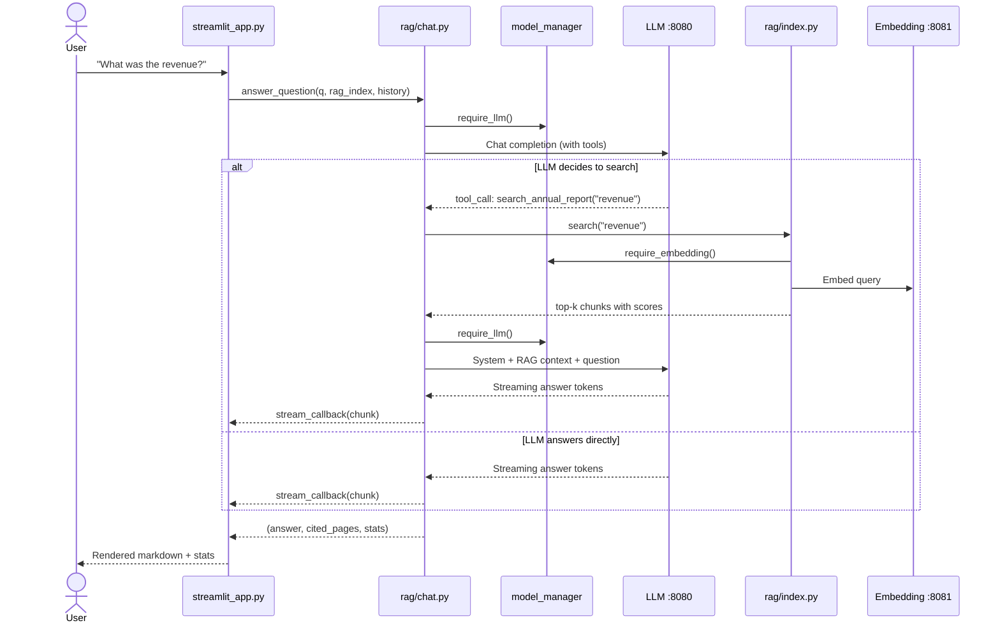
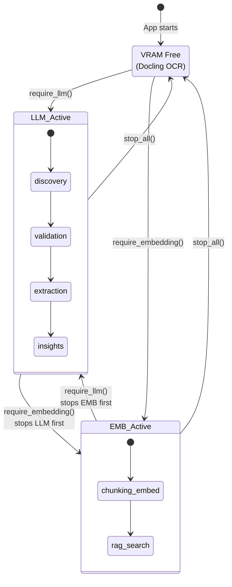
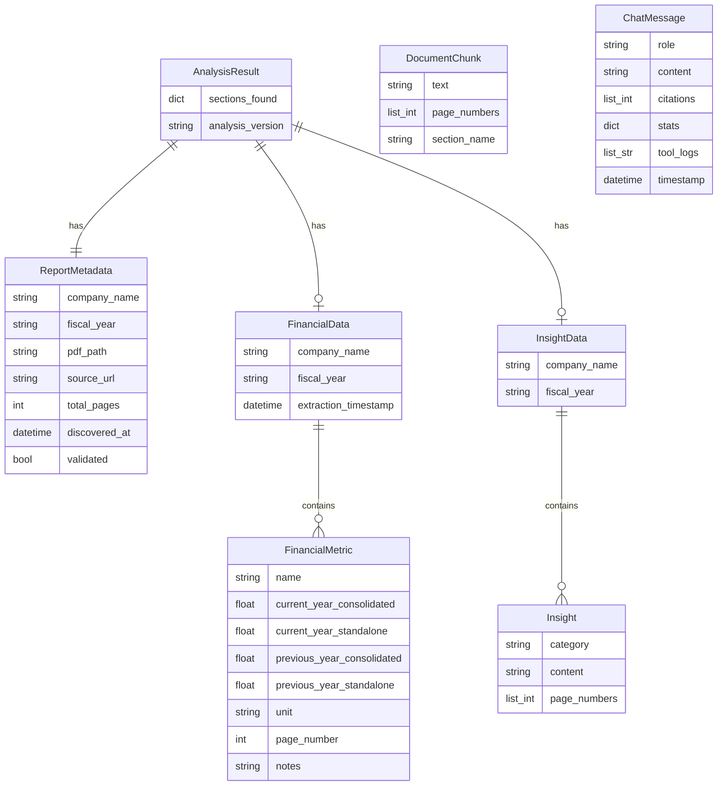

# 🏗️ Architecture Guide — Annual Report Analyzer V1

**3,958 lines** · **31 `.py` files** · **4 packages** · fully local (no cloud APIs)

---

## 1. System Overview

The 30,000-foot view — what talks to what:



### Key insight
The UI layer (`streamlit_app.py`) **never touches pipeline logic directly**. It creates a [`PipelineOrchestrator`](file:///home/prant/Desktop/python/job/Annual%20Report%20Analyzer%20V1/pipeline/orchestrator.py) and wires Streamlit widgets as callbacks. This means you could replace Streamlit with a CLI, FastAPI, or anything else by just providing different callbacks.

---

## 2. Module Dependency Graph

Who imports whom — follow the arrows to understand coupling:



### Reading the graph
- **Leaves** (no outgoing arrows): `config.py`, `schema.py` — these are pure definitions, safe to edit without breaking anything downstream.
- **Root** (no incoming arrows): `streamlit_app.py` — the entry point.
- **High fan-in nodes**: `schema.py` and `config.py` are imported by almost everything. Changes here ripple everywhere.
- **Isolated clusters**: `export/` only depends on `schema.py` — completely independent from the pipeline.

---

## 3. Pipeline Sequence (the main flow)

What happens when you click "Analyze":



### Debugging tip
Each phase is a **separate method call** in [`orchestrator.py`](file:///home/prant/Desktop/python/job/Annual%20Report%20Analyzer%20V1/pipeline/orchestrator.py). If the pipeline fails, check `logs/app.log` — the orchestrator logs `Pipeline step X/8: <label>` at each phase, so you can pinpoint exactly where it stopped.

---

## 4. RAG Chat Flow (the interactive part)

What happens when you ask a question in the chat tab:



### Key detail
The LLM **decides** whether to use the search tool. Conversational questions ("hi", "thanks") get answered directly. Factual questions ("what was the EBITDA?") trigger the search → embed → retrieve → generate cycle.

---

## 5. VRAM Lifecycle (why `model_manager` exists)

This project runs on a **single GPU** that can't hold the LLM + Embedding model + Docling simultaneously. The `ModelManager` swaps them:



### The swap sequence during pipeline:
1. **LLM loaded** → discovery, validation
2. **Stop all** → free VRAM for Docling PDF parsing (PyTorch)
3. **Embedding loaded** → chunk embedding, FAISS index
4. **LLM loaded** → extraction (agentic), insight generation
5. **During chat**: swaps between LLM ↔ Embedding per tool call

---

## 6. Data Model

How data flows through the system:



All models live in [`pipeline/schema.py`](file:///home/prant/Desktop/python/job/Annual%20Report%20Analyzer%20V1/pipeline/schema.py) (107 lines). `ChatMessage` lives in session state only — never persisted to cache.

---

## 7. Debugging Guide

### "Where do I look?"

| Symptom | File to check | Function / area |
|---------|--------------|-----------------|
| **Search finds wrong PDFs** | [`search.py`](file:///home/prant/Desktop/python/job/Annual%20Report%20Analyzer%20V1/pipeline/discovery/search.py) | `_rank_with_llm()` — check `_RANKING_SYSTEM_PROMPT` |
| **PDF download fails** | [`browser.py`](file:///home/prant/Desktop/python/job/Annual%20Report%20Analyzer%20V1/pipeline/discovery/browser.py) | `_try_direct_download()` then `_try_browser_download()` |
| **Validation rejects a valid PDF** | [`validate.py`](file:///home/prant/Desktop/python/job/Annual%20Report%20Analyzer%20V1/pipeline/discovery/validate.py) | `_llm_validate()` — check `_VALIDATION_SYSTEM_PROMPT` |
| **PDF parsing garbled** | [`parse.py`](file:///home/prant/Desktop/python/job/Annual%20Report%20Analyzer%20V1/pipeline/parsing/parse.py) | `parse()` — Docling converter config |
| **Sections not detected** | [`sections.py`](file:///home/prant/Desktop/python/job/Annual%20Report%20Analyzer%20V1/pipeline/parsing/sections.py) | `_regex_scan()` then `_semantic_fallback()` |
| **Wrong financial numbers** | [`extract.py`](file:///home/prant/Desktop/python/job/Annual%20Report%20Analyzer%20V1/pipeline/extraction/extract.py) | `_agentic_find_metric()` — check `_EXTRACTION_SYSTEM_PROMPT` and tool definitions |
| **Bad insights** | [`insights.py`](file:///home/prant/Desktop/python/job/Annual%20Report%20Analyzer%20V1/pipeline/extraction/insights.py) | `_generate_category()` — check `_INSIGHT_SYSTEM_PROMPT` |
| **Chat gives wrong answers** | [`chat.py`](file:///home/prant/Desktop/python/job/Annual%20Report%20Analyzer%20V1/pipeline/rag/chat.py) | `answer_question()` — check `_CHAT_SYSTEM_PROMPT` and tool schema |
| **Chat search misses info** | [`index.py`](file:///home/prant/Desktop/python/job/Annual%20Report%20Analyzer%20V1/pipeline/rag/index.py) | `search()` — check `top_k` and `threshold` params |
| **VRAM OOM / server crash** | [`model_manager.py`](file:///home/prant/Desktop/python/job/Annual%20Report%20Analyzer%20V1/pipeline/model_manager.py) | `require_llm()` / `require_embedding()` — check swap timing |
| **Pipeline hangs at a step** | [`orchestrator.py`](file:///home/prant/Desktop/python/job/Annual%20Report%20Analyzer%20V1/pipeline/orchestrator.py) | Check `logs/app.log` for last `Pipeline step X/8` |
| **Cache returns stale data** | [`cache.py`](file:///home/prant/Desktop/python/job/Annual%20Report%20Analyzer%20V1/pipeline/cache.py) | `get_report()` / `save_report()` — check `data/cache.db` |
| **UI rendering issues** | [`streamlit_app.py`](file:///home/prant/Desktop/python/job/Annual%20Report%20Analyzer%20V1/app/streamlit_app.py) | `_render_financials_tab()` / `_render_chat()` |
| **Export broken** | [`to_markdown.py`](file:///home/prant/Desktop/python/job/Annual%20Report%20Analyzer%20V1/export/to_markdown.py) / [`to_pdf.py`](file:///home/prant/Desktop/python/job/Annual%20Report%20Analyzer%20V1/export/to_pdf.py) | `export_markdown()` / `export_pdf()` |

### Quick debug workflow
```bash
# 1. Check the log for the last error
tail -50 logs/app.log

# 2. Test a single module in isolation
python -c "
from pipeline.parsing.parse import ReportParser
p = ReportParser()
r = p.parse('path/to/test.pdf')
print(f'{r.total_pages} pages')
"

# 3. Test extraction independently
python -c "
import asyncio
from pipeline.extraction.extract import FinancialExtractor
e = FinancialExtractor()
sections = {'Profit & Loss': 'your text here...'}
result = asyncio.run(e.extract(sections, 'TestCorp', '2024'))
print(result)
"

# 4. Test RAG search quality
python -c "
import asyncio
from pipeline.rag.index import RAGIndex
from pipeline.cache import ReportCache
idx = RAGIndex(cache=ReportCache())
idx.load_index('company_id')
results = asyncio.run(idx.search('revenue'))
for chunk, score in results:
    print(f'{score:.3f} | {chunk.text[:80]}...')
"
```

---

## 8. Which Diagram to Use When

| You want to… | Use diagram |
|--------------|-------------|
| Understand the big picture | **§1 System Overview** |
| Know what imports what (before editing) | **§2 Dependency Graph** |
| Debug a pipeline failure | **§3 Pipeline Sequence** |
| Debug chat quality | **§4 RAG Chat Flow** |
| Debug VRAM / OOM crashes | **§5 VRAM Lifecycle** |
| Understand the data structures | **§6 Data Model** |
| Find the right file to edit | **§7 Debugging Guide** |

---

## File Map (quick reference)

```
Annual Report Analyzer V1/
├── app/
│   └── streamlit_app.py     563L  UI layer (renders, wires callbacks)
├── pipeline/
│   ├── config.py              25L  ★ All config constants
│   ├── schema.py             107L  ★ All Pydantic data models
│   ├── orchestrator.py       278L  Pipeline runner (framework-agnostic)
│   ├── model_manager.py      132L  VRAM swap (LLM ↔ Embedding)
│   ├── cache.py              210L  SQLite + FAISS persistence
│   ├── discovery/
│   │   ├── search.py         224L  Tavily search + LLM ranking
│   │   ├── browser.py        202L  httpx + Playwright PDF download
│   │   └── validate.py       187L  LLM-based PDF validation
│   ├── parsing/
│   │   ├── parse.py          171L  Docling PDF → Markdown
│   │   ├── sections.py       245L  Regex + semantic section split
│   │   └── chunking.py       116L  Page-aware text chunking
│   ├── extraction/
│   │   ├── extract.py        370L  Agentic financial metric extraction
│   │   └── insights.py       150L  LLM insight generation
│   └── rag/
│       ├── index.py          186L  FAISS embed/index/search
│       └── chat.py           291L  Tool-calling chat agent
├── export/
│   ├── to_markdown.py        107L  Markdown report export
│   └── to_pdf.py             189L  PDF report export (fpdf2)
└── tests/                    195L  pytest suite
```
